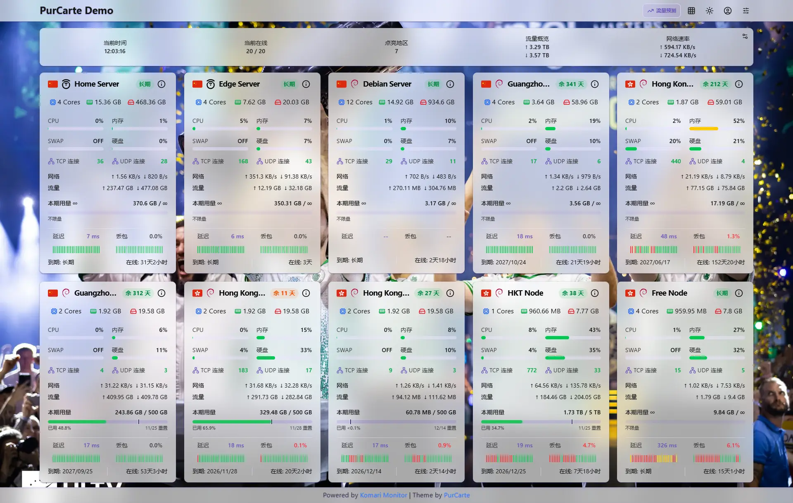

# PurCarte

面向 Komari 的紧凑卡片主题。当前最终整理版为 **v1.2.0**。

- 宽屏自动显示五列卡片，手机保持单列。
- 连续流量进度条按精确比例填充；短竖线表示本账期已过去的时间比例，用量超过时间进度时变黄。
- 延迟与丢包保留柱状小图，任务可按节点选择。
- 完整机器详情在悬浮窗口中打开，支持返回、关闭、Esc 和遮罩关闭，保留卡片列表和滚动位置。
- 独立流量预测总览，以及流量预测、流媒体检测、负载、延迟四个详情标签。
- 设置支持导入、导出、实时预览、取消恢复和保存，站点默认与浏览器偏好分开。



示例图使用匿名节点名称展示最终布局；个人节点和管理配置不随仓库发布。

## 安装

在 [Releases](https://github.com/M1nt18/komari-theme-purcarte/releases) 下载主题 zip，在 Komari 后台上传并启用。
真实周期账本、预测和手动流媒体检测需要单独安装配套服务，基础监控和原生图表使用现有 Komari API。

完整步骤和兼容性：[安装与升级](docs/INSTALL.md)。
设置行为及审查结果：[最终审查说明](docs/FINAL-REVIEW.md)。
版本变化：[CHANGELOG.md](CHANGELOG.md)。

## 构建和验证

需要 Node.js 22.18+、Python 3.10+。

```bash
npm ci
npm run typecheck
npm run lint
npm test
npm run build
npm run package
```

`release/` 输出主题包、可选服务包和 SHA256 清单。发布物不包含账号、Token、数据库、用户节点配置或生产服务器脚本。

本地开发默认仅监听 `127.0.0.1`，API 目标通过 `.env.local` 的 `VITE_API_TARGET` 指定。`npm run review` 可启动仅在本机运行的只读审查预览，设置保存只进入该预览的内存，不写远端站点。

## 代码关系

`src/` 为唯一前端源码；`komari-theme.json` 的设置元数据与 `src/config/default.ts` 由测试逐项对齐。
`integrations/traffic-ledger/` 只读 Komari 源库、独立保存账本和检测队列；`integrations/unlock-worker/` 是仅执行固定流媒体检测的节点组件。
`tools/package_release.py` 统一打包；不再对压缩 JavaScript 做字符串补丁。

本主题源自 [Montia37/komari-theme-purcarte](https://github.com/Montia37/komari-theme-purcarte)，保留 MIT 许可与上游作者署名。
预测计算参考 [Komari-Plugin-NetForecast](https://github.com/livingfree2023/Komari-Plugin-NetForecast)，相关许可随源码保留。
流媒体检测器来源 [HsukqiLee/MediaUnlockTest](https://github.com/HsukqiLee/MediaUnlockTest)。
